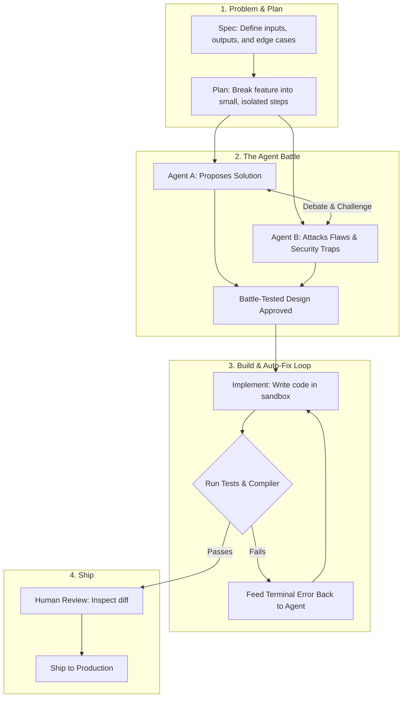

# Svay Monirath

**Software Engineer**  
Phnom Penh, Cambodia | [Email](mailto:svaymonirathofficial@gmail.com) | [GitHub](https://github.com/SvayMonirath) | [LinkedIn](https://linkedin.com/in/svay-monirath)

I build real-time voice backends, developer tools, and agent workflows that ship reliable software without the chaos.

---

## How I Build With AI: The Everyday Loop

Most AI tools act like agreeable junior developers: you suggest a bad idea, they say *"Great idea!"*, and write 500 lines of vulnerable code.

My workflow stops bad ideas before they become bugs. I pit agents against each other to challenge assumptions, write code inside sandboxes, and let real compilers and tests do the grading:

### The 3 Core Rules

1. **The Agent Battle (Challenge Opinions First)**  
   Before touching code, Agent A writes the plan and Agent B tries to poke holes in it. They argue over edge cases, security traps, and race conditions until only a battle-tested design remains. Catching mistakes here costs seconds; catching them in production costs weeks.

2. **The Auto-Fix Feedback Loop**  
   Code runs in an isolated sandbox against real test suites and type checkers. If a test fails, the exact terminal error feeds right back into the model to fix itself automatically (capped at 3 to 5 loops so it never spins out).

3. **Compilers Over AI Debates**  
   We never ask an LLM if code works—we ask the compiler, linter, and unit tests. The test suite is the only ground truth.

---

## What I Built & What I Learned

### 1. Cosmo — Agent Workspace & Sandboxes
- **What I built:** An isolated developer workspace where coding agents run in Docker sandboxes with safety gates that stop accidental overwrites.
- **What I learned:** If you don't lock down file boundaries, an agent will literally pass failing unit tests by deleting the test assertions. Always mount test suites as read-only.

### 2. Veaja — Real-Time Voice AI Platform
- **What I built:** A low-latency voice receptionist system supporting duplex audio, phone telephony, and calendar bookings across 59 languages.
- **What I learned:** Prompt engineering doesn't fix dropped audio packets. Real-time audio lives or dies by low-latency WebSockets, packet buffers, and solid backend plumbing.

### 3. Wisp — Audio Studio & Pitch Engine
- **What I built:** A browser-native vocal pitch tracker and audio editor with offline-first local storage.
- **What I learned:** Heavy third-party frameworks destroy 60fps audio performance on low-end laptops. Building lightweight, browser-native state machines always wins over bloated libraries.

### 4. Better Communication — High-Stakes Conversation Simulator
- **What I built:** A conversational judgment practice studio where engineers and managers practice difficult negotiations against realistic AI counter-parties.
- **What I learned:** People don't build confidence by reading theory or chatting with polite bots. They learn by making real mistakes in tough scenarios and seeing exactly where their tactics broke down.

---

## Tech Stack

- **Languages:** TypeScript, Python, C++, Go
- **Backend & Real-Time:** NestJS, FastAPI, Fastify, WebSockets, WebRTC
- **Data & Infrastructure:** PostgreSQL, Redis, Docker, Temporal, Linux
