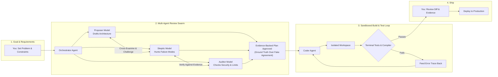

# Svay Monirath

**Software Engineer**  
Phnom Penh, Cambodia | [Email](mailto:svaymonirathofficial@gmail.com) | [GitHub](https://github.com/SvayMonirath) | [LinkedIn](https://linkedin.com/in/svay-monirath)

I build real-time voice backends, developer tools, and agent workflows that ship reliable software without the chaos.

---

## How I Build With AI: The Multi-Agent Engineering Workflow

Most AI tools act like agreeable junior developers: you give them a bad idea, they smile, say *"Great idea!"*, and write 500 lines of broken code.

My workflow stops bad ideas before they become bugs. I use a dynamic multi-agent review swarm to battle-test ideas across different models, write code inside isolated sandboxes, and let real terminal test suites grade the output:

---

### How the Workflow Works in Practice

#### 1. The Multi-Agent Review Swarm (Evidence Over Agreement)
Before touching any code, we run a dynamic review swarm coordinated by an Orchestrator:
- **Not Limited to One Model**: We pull perspectives from multiple models and specialized analytical roles (Architect, Skeptic, Security Auditor).
- **Challenging, Not Forcing Consensus**: Just because two models agree does not make them right—models often share the same blind spots. Instead of forcing unanimous agreement, models cross-examine each other:
  - *"What if the network drops mid-stream?"*
  - *"How does this table lock under 10,000 concurrent requests?"*
  - *"Where is the empirical proof or documentation for this library call?"*
- **The Orchestrator** evaluates the debate claim-by-claim. The winning plan is chosen by **hard evidence and real constraints**, not by model voting.

#### 2. The Sandboxed Build & Auto-Fix Loop
Once the plan is locked down, execution shifts to a focused coding agent:
- **Sandbox Isolation**: Code runs inside an isolated workspace (Docker / ephemeral branch) so work in progress cannot mutate production state.
- **Terminal as the Sole Truth**: We never ask an AI if the code works. The terminal compiler and automated test suites (`vitest`, `pytest`, `tsc`) execute automatically.
- **Closed Error-Trace Loop**: If a test fails, the exact terminal `stderr` error trace is fed right back into the coder agent to fix itself automatically (capped at 3 to 5 tries to prevent runaway loops).

#### 3. Tech Lead Review (You in Control)
- AI agents never deploy directly to production.
- I act as the final gatekeeper: reviewing the clean git diff, verifying the test evidence, and shipping to production.

---

## What I Built & What I Learned

### 1. Cosmo — Agent Workspace & Sandboxes
- **What I built:** An isolated developer workspace where coding agents run in Docker sandboxes with safety gates that stop accidental overwrites.
- **What I learned:** If you don't lock down file boundaries, an agent will literally pass failing unit tests by deleting the test assertions. Always mount test suites as read-only.

### 2. Veaja — Real-Time Voice AI Platform
- **What I built:** A low-latency voice receptionist system supporting duplex audio, phone telephony, and calendar bookings across 59 languages.
- **What I learned:** Prompt engineering doesn't fix dropped audio packets. Real-time audio lives or dies by low-latency WebSockets, packet buffers, and solid backend plumbing.

### 3. Wisp — Audio Studio & Pitch Engine
- **What I built:** A browser-native vocal pitch tracker and audio editor with offline-first local storage.
- **What I learned:** Heavy third-party frameworks destroy 60fps audio performance on low-end laptops. Building lightweight, browser-native state machines always wins over bloated libraries.

### 4. Better Communication — High-Stakes Conversation Simulator
- **What I built:** A conversational judgment practice studio where engineers and managers practice difficult negotiations against realistic AI counter-parties.
- **What I learned:** People don't build confidence by reading theory or chatting with polite bots. They learn by making real mistakes in tough scenarios and seeing exactly where their tactics broke down.

---

## Tech Stack

- **Languages:** TypeScript, Python, C++, Go
- **Backend & Real-Time:** NestJS, FastAPI, Fastify, WebSockets, WebRTC
- **Data & Infrastructure:** PostgreSQL, Redis, Docker, Temporal, Linux
